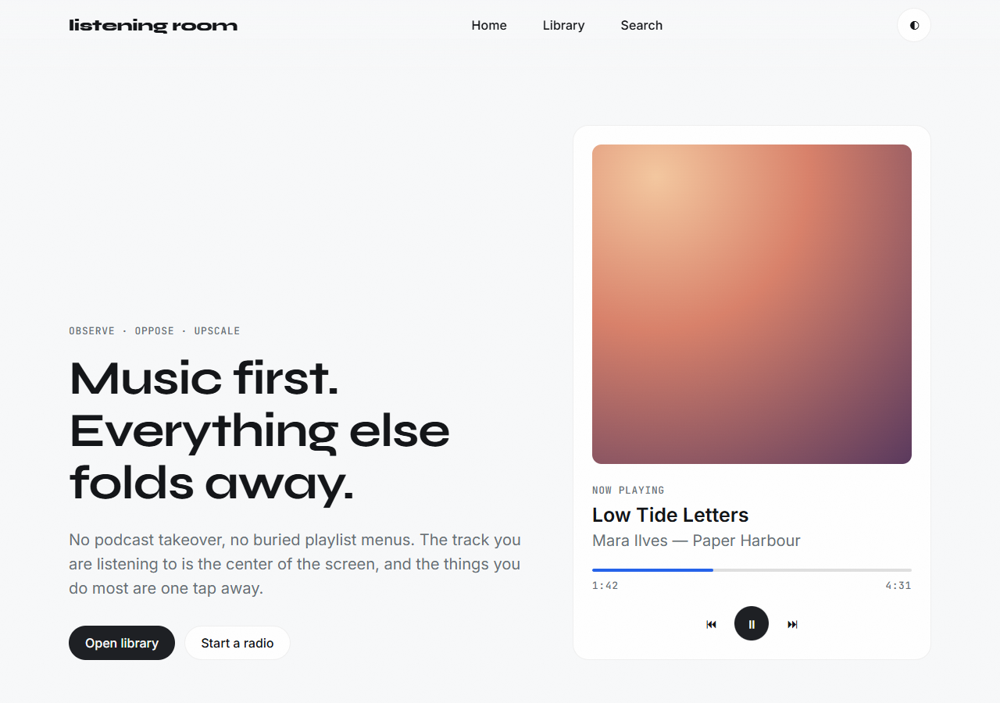
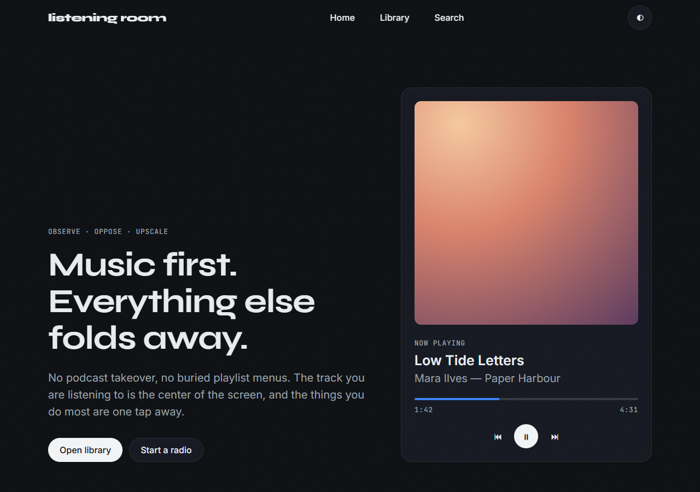
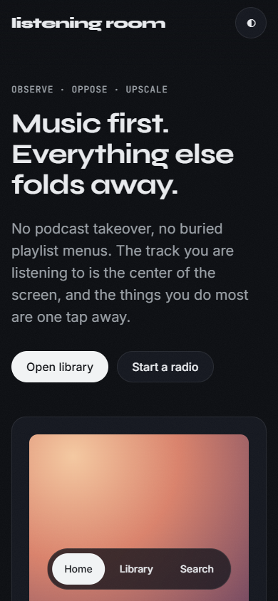

# juxtopposed-design-skill

**Observe. Oppose. Upscale.** — an Agent Skill that teaches Claude (and other skill-aware agents) an
opinionated, anti-generic UI/UX design language: flow-first process, 60-30-10 color, tinted-graphite
dark mode, a modular type scale, soft geometry, progressive blur and fast spring-like motion.



<p>
  
  
</p>

> **Unofficial.** A research-based interpretation of the public design commentary of the YouTube creator
> [Juxtopposed](https://www.youtube.com/@juxtopposed) (redesign series, UI course, Realtime Colors).
> Not affiliated with or endorsed by the creator. Exact hex values, fonts and numbers are codified
> defaults for an AI to follow, not quotes.

## Install (pick one)

### Claude Code — plugin (recommended, 2 commands)

Inside Claude Code:

```text
/plugin marketplace add miskibin/juxtopposed-design-skill
/plugin install juxtopposed-design@juxtopposed-design-skill
```

### Claude Code — copy the folder

```bash
git clone https://github.com/miskibin/juxtopposed-design-skill
cp -r juxtopposed-design-skill/skills/juxtopposed-design ~/.claude/skills/
```

Windows (PowerShell):

```powershell
git clone https://github.com/miskibin/juxtopposed-design-skill
Copy-Item -Recurse juxtopposed-design-skill\skills\juxtopposed-design $HOME\.claude\skills\
```

For a single project only, copy it to `<your-project>/.claude/skills/` instead.

### Claude.ai / Claude Desktop

1. Download `juxtopposed-design.zip` from the [latest release](https://github.com/miskibin/juxtopposed-design-skill/releases/latest).
2. **Settings → Capabilities → Skills → Upload skill**, select the zip.
3. Make sure the skill is toggled on.

### Other agents

The skill is a plain folder with a `SKILL.md`. Point any skill-aware agent at
`skills/juxtopposed-design/`, or paste `SKILL.md` into a system prompt.

## Use it

It triggers automatically on UI work. You can also ask explicitly:

- "Build a settings page for my app in the Juxtopposed style."
- "Critique our dashboard — Observe, Oppose, Upscale."
- "Make me a dark mode that doesn't hurt on OLED."
- "Generate a 5-token palette and check its contrast."

## What's inside

```
skills/juxtopposed-design/
├── SKILL.md                  # the rules the model follows
├── references/
│   ├── philosophy.md         # method, process, case studies → 6 rules
│   ├── color.md              # 60-30-10, palette algorithm, dark mode, WCAG table
│   ├── typography.md         # pairings, modular scales, measure
│   ├── materiality.md        # radii, hairlines, progressive blur, grain, motion code
│   ├── tokens.css            # drop-in CSS variables, light + dark
│   ├── tokens.md             # Tailwind v4/v3 mapping + class recipes
│   └── checklist.md          # pre-ship review
├── scripts/contrast.py       # WCAG checker: `python contrast.py --audit tokens.css`
└── examples/demo.html        # reference page (screenshots above)
```

## The rules in one screen

| Area | Rule |
|---|---|
| Process | Flow → wireframe → tokens → hi-fi. Never style first. |
| Ergonomics | Content isolation, friction reduction, context decoupling; mobile is thumb-first. |
| Color | 3–6 tokens, 60-30-10, body text ≥ 7:1, no `#000`/`#fff` dark mode — tinted graphite with lighter raised surfaces. |
| Type | Expressive display + neutral text face, Major Third 1.250 scale, ≤ 65ch lines. |
| Material | 16–24 px cards, pill buttons, 1 px hairlines instead of shadows, progressive blur, subtle grain. |
| Motion | 150–250 ms, `cubic-bezier(0.16, 1, 0.3, 1)`, honor reduced motion. |
| Restraint | Signature styles only as accents — never on functional text. |

## License

MIT
